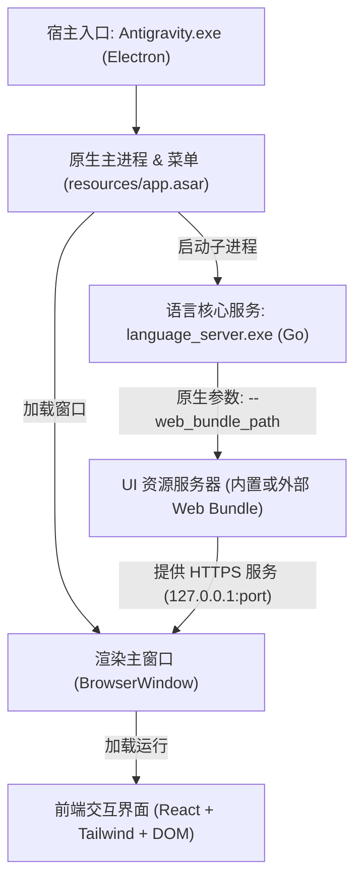

# AntiGravity 客户端汉化可行性分析与实施方案

本报告基于对当前系统运行中的 AntiGravity 客户端（v2.23.0）进行的逆向与运行时环境探测，全面评估汉化 AntiGravity 客户端的**技术可行性、架构实现路径、潜在风险及最佳实施方案**。

---

## 结论先行：可行性极高（★★★★★）

**汉化 AntiGravity 客户端完全可行，且存在原厂官方原生支持的外部资源覆盖机制！**

在探测 `language_server.exe` 时，我们发现其暴露了一个极为关键的启动参数：
```text
-web_bundle_path="": Directory or .zip holding the compiled web UI to serve, in preference to the bundle compiled into this binary.
```
这表明 Google 团队在开发阶段就预留了**使用外部目录/ZIP 覆盖内置前端 Web Bundle 的原生通道**，这为非破坏性、高兼容性的客户端汉化提供了绝佳的技术支撑。

---

## 1. 客户端架构全景剖析

AntiGravity 客户端采用了**三层混合架构**：



### 各层分布与汉化关注点

| 组件层级 | 文件位置 | 技术栈 | 汉化内容 | 推荐处理策略 |
| :--- | :--- | :--- | :--- | :--- |
| **1. 原生桌面层** | `resources\app.asar`<br/>(`dist/menu.js`, `dist/tray.js`) | Node.js / Electron | 顶部原生菜单（File, Edit, View, Help, Connect to WSL 等）、托盘菜单、确认退出弹窗 | 解包 `app.asar`，替换菜单模板文本并重新打包 |
| **2. 核心调度层** | `resources\bin\language_server.exe` | Go 编译二进制 (~161MB) | 提供本地 Web 静态服务、与 Google API 通信 | **无需修改二进制文件**，仅利用其 `--web_bundle_path` 参数 |
| **3. 前端交互层** | 嵌入在二进制中的 ZIP 包<br/>（解压后约 10MB） | React SPA (`index.html`, `main.js`, CSS) | 90% 以上的界面：聊天窗口、设置面板、工作区列表、按钮、输入框占位符、Tooltips | 解包 web bundle，注入动态字典补丁 `i18n.js` 并覆盖加载 |

---

## 2. 方案对比与技术选型

针对 AntiGravity 客户端的汉化，我们评估了以下三种路线：

| 维度 | 方案 A：Web Bundle 外部覆盖 + 动态字典注入（推荐） | 方案 B：纯 Electron Preload 脚本注入 | 方案 C：静态反编译替换 `main.js` |
| :--- | :--- | :--- | :--- |
| **侵入性** | **极低**（通过官方参数重定向 bundle） | **低**（修改 `preload.js`） | **高**（修改 9.9MB 混淆 JS） |
| **稳定性** | **极高**（不破坏 React 编译状态与事件） | **高**（受限于跨域和页面加载时序） | **中**（容易误伤逻辑标识符导致白屏） |
| **更新维护** | **极佳**（词典独立维护，版本升级只需重跑脚本） | **良好** | **极差**（每次版本更新需重新比对替换） |
| **翻译覆盖率** | **95%+**（动态监听 DOM，捕获所有动态渲染） | **90%+** | **85%**（部分动态拼接文本难以匹配） |

### 推荐选型：**方案 A + 原生菜单协同补丁**
- **原生菜单部分**：微调 `app.asar` 中的 `menu.js`，将系统级菜单本地化；
- **Web 界面部分**：提取 `web_bundle`，在 `index.html` 中注入轻量高性能的 `zh-CN.js` 字典引擎，利用 `MutationObserver` 实时替换中文字符；
- **启动关联**：在 `app.asar/dist/languageServer.js` 中自动注入 `--web_bundle_path`。

---

## 3. 详细实施规划

### 阶段一：资源提取与独立（已成功验证）
- [x] 定位 `language_server.exe` 中内置 ZIP 包的物理偏移地址（`142679243` 至 `146565027`）。
- [x] 成功导出原始 `web_bundle.zip` 并解压，包含完整的 `index.html`, `main.js`, `jetbox.css`, `compiled_tailwind.css` 等。
- [ ] 将解压后的 Web 资源归档至 `%LOCALAPPDATA%\Programs\antigravity\resources\web_bundle_zh`。

### 阶段二：原生菜单汉化（`app.asar`）
修改 `resources\app.asar` 中的 `dist/menu.js`，将顶部原生菜单中文化：
- `File` -> `文件(&F)`
- `New Window` -> `新建窗口(&N)`
- `Connect to WSL` -> `连接至 WSL(&W)`
- `Reopen Locally` -> `在本地重新打开`
- `Edit` -> `编辑(&E)`
- `View` -> `视图(&V)`
- `Help` -> `帮助(&H)`
- `Docs` -> `官方文档`

### 阶段三：前端动态词典引擎（`zh-CN.js`）
在 `web_bundle_zh/index.html` 中插入 `<script src="/zh-CN.js"></script>`。
该脚本负责：
1. **建立词条映射库**：
   - 核心功能区：`Chat`（对话）、`Artifacts`（产物）、`Context`（上下文）、`Review`（审查）、`Workspaces`（工作区）。
   - 常用操作：`Accept all`（接受全部）、`Reject all`（拒绝全部）、`Send a message`（发送消息）、`Search`（搜索）、`Clear conversation`（清空对话）。
   - 设置选项：`Settings`（设置）、`General`（常规）、`Account`（账户）、`Experimental Features`（实验特性）。
2. **高性能 DOM 观察器 (MutationObserver)**：
   - 深度监控 `#root` 节点的文本变动，对新增和变化的 `Node.TEXT_NODE`、`placeholder`、`title`、`aria-label` 进行字典瞬时匹配与翻译。
   - 针对代码块（`<pre>`, `<code>`, `.monaco-editor`）设置翻译白名单，**坚决不替换代码和模型输出正文**，保证编程体验纯净。

### 阶段四：自动化安装与恢复脚本（PowerShell）
为应对客户端日常升级，开发配套自动化工具：
1. `install-cn.ps1`：
   - 自动检测并备份原始 `app.asar` 为 `app.asar.bak`；
   - 提取最新 bundle（或使用预制字典），注入汉化配置；
   - 重启客户端完成汉化生效。
2. `uninstall-cn.ps1`：
   - 一键还原官方原始 `app.asar`，删除自定义 `web_bundle_zh`，完全恢复初始状态。

---

## 4. 关键风险与应对措施

> [!IMPORTANT]
> **关于客户端自动更新覆盖**
> AntiGravity 会在后台自动拉取新版更新。官方更新后会直接替换 `app.asar` 和 `language_server.exe`。
> **应对方式**：我们的方案是**完全可逆、脚本化**的，只要保留汉化词库与脚本，每次升级后仅需 3 秒运行一次 `install-cn.ps1` 即可重新激活汉化。

> [!WARNING]
> **关于代码区与模型生成内容的防污染**
> 汉化只能针对客户端自身的 UI 标签、按钮、菜单和提示，**绝对不能**误翻译模型生成的 Markdown 内容、代码片段、终端输出和 Slash 命令（例如 `/plan`, `/goal`, `@codebase`）。
> **应对方式**：在 `zh-CN.js` 中增加选择器穿透保护，过滤掉所有属于对话输出容器、CodeBlock、Terminal 区域的 DOM 节点。

---

## 5. 用户确认与后续行动

请确认您是否希望我们按照本方案开始实施：
1. **轻量试点**：先为顶部桌面菜单和高频核心界面（主按钮、设置项、输入区）建立第一批词库并测试效果；
2. **完整覆盖**：编写自动化安装/还原脚本及覆盖率更全的本地化词典。
